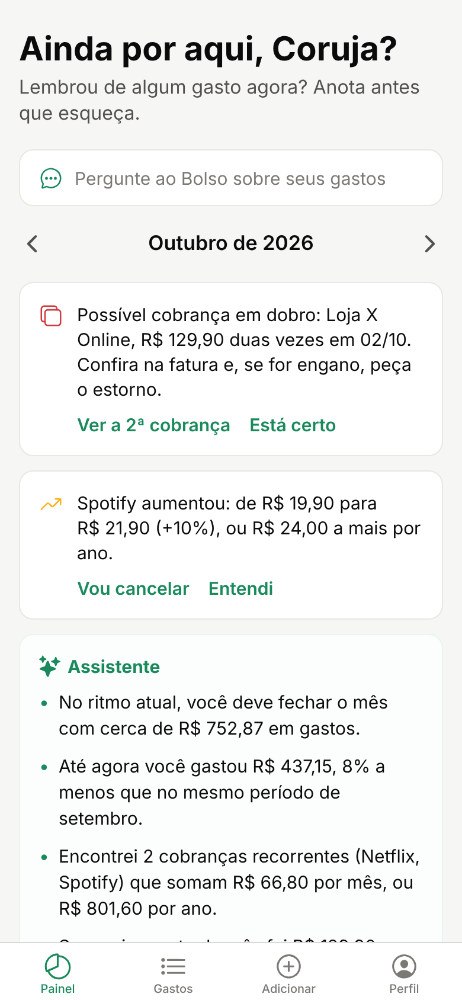
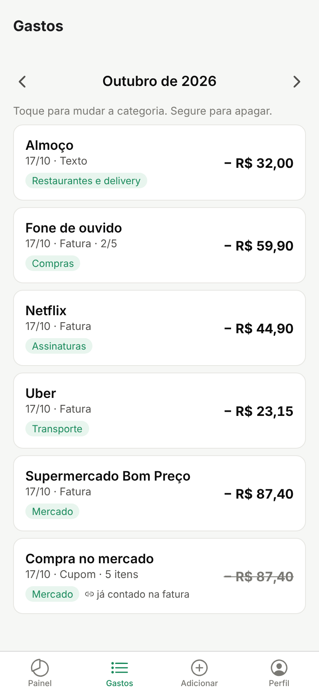
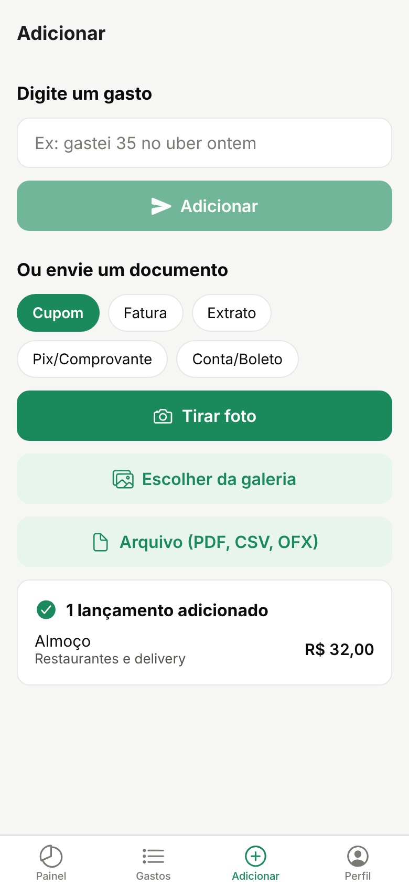

# Bolso

Controle de gastos pessoais em que **a IA faz o trabalho chato**. Tire foto do cupom, envie o PDF da fatura ou o extrato do banco, ou só digite *"gastei 35 no uber ontem"*: o Bolso lê, separa as transações, categoriza e monta o painel do mês.

<p align="center">
  
  
  
</p>

## O que ele faz

- **Lê qualquer comprovante de gasto:** cupom fiscal (foto, item por item), fatura de cartão em PDF (inclusive parcelas "3/10"), extrato CSV/OFX, print de Pix e contas de consumo.
- **Gasto por texto:** frases simples são entendidas no próprio servidor, sem gastar créditos da IA; as mais complexas vão para a IA.
- **Memória de categorias:** quando você corrige a categoria de um lugar, o Bolso lembra e nunca mais pergunta.
- **Conciliação:** o mesmo gasto que chega pelo cupom e pela fatura é contado uma vez só. A fatura vale como valor oficial e o cupom guarda os itens. Fatura reenviada não duplica nada.
- **Painel do mês** com gastos por categoria, entradas e saldo.
- **Assistente do mês:** compara com o mês anterior, prevê o fechamento, aponta gastos fora do padrão e orçamentos estourando. As contas são feitas em código; a IA (Haiku) só escreve as dicas, no máximo uma vez por dia, por menos de US$ 0,001 cada. Sem IA, o cartão mostra os mesmos fatos em texto pronto.
- **Orçamentos por categoria** com medidor e alerta a partir de 80%.
- **Cobranças recorrentes detectadas** (assinaturas, aluguel...), avisando quando uma parou de cobrar.
- **Custo da IA sob controle:** cada chamada à API do Claude é registrada, e o app mostra quanto dos créditos já foi usado no mês.
- **Contas e cartões:** cada lançamento pode ser ligado a um cartão ou conta, e o painel mostra quanto saiu de cada um no mês.
- **Edição completa e lançamento manual:** corrija valor, data, descrição, categoria e conta, ou lance um gasto à mão, sem IA.
- **Histórico de envios:** veja o que foi lido, o que deu erro, e apague um envio junto com os lançamentos dele se a leitura saiu errada.
- **Privacidade:** a foto ou o PDF original é apagado assim que é lido. Você pode exportar todos os lançamentos em planilha (CSV para Excel) e excluir a conta com tudo dentro.

## Arquitetura

```
App Expo (React Native) ──► API Node/Express ──► fila na tabela Documento
                                   │                        │
                                   │             API do Claude (visão + PDF,
                                   │             saída em JSON validada por schema)
                                   │                        │
                                   └──── Postgres (Supabase) via Prisma ◄──┘
                                         conciliação + memória de categorias
```

- **back/**: Node 20+, Express, Prisma, Zod e SDK `@anthropic-ai/sdk`. O upload responde na hora (202) e a leitura acontece em segundo plano, com uma fila simples feita na própria tabela `Documento` (`FOR UPDATE SKIP LOCKED`), sem precisar de Redis.
- **mobile/**: Expo SDK 58, Expo Router com abas, câmera, galeria e seletor de arquivos.

## Rodando localmente

### 1. Back-end

```bash
cd back
cp .env.example .env    # preencha DATABASE_URL, DIRECT_URL e JWT_SECRET
npm install
npx prisma migrate deploy
npm run dev
```

Com `IA_MOCK=true` (padrão do `.env.example`) a API devolve respostas prontas de `src/ia/mocks/`, e você desenvolve as telas **sem gastar créditos**. Para usar a IA de verdade, coloque sua `ANTHROPIC_API_KEY` e mude para `IA_MOCK=false`.

Serve qualquer Postgres. Para usar o Supabase: crie um projeto, clique em **Connect > ORMs > Prisma** e copie as duas URLs (pooler na porta 6543 para `DATABASE_URL` e conexão direta na porta 5432 para `DIRECT_URL`).

### 2. App

```bash
cd mobile
cp .env.example .env    # EXPO_PUBLIC_API_URL=http://IP-DO-SEU-PC:3000
npm install
npx expo start
```

Abra com o **Expo Go** no celular (escaneie o QR code). No celular, `localhost` é o próprio celular, então use o IP do computador na rede Wi-Fi.

### 3. Testes

```bash
cd back
npm test                                                  # testes unitários
TEST_DATABASE_URL=postgresql://... npm test               # + integração (use um banco só para testes: ele é apagado)
```

## Deploy (grátis)

1. **Banco:** projeto no [Supabase](https://supabase.com), plano gratuito.
2. **API:** no [Render](https://render.com), use **New > Blueprint** apontando para este repositório (o `render.yaml` já configura tudo) e preencha `DATABASE_URL`, `DIRECT_URL` e `ANTHROPIC_API_KEY`. As migrations rodam no build.
3. **App:** troque `EXPO_PUBLIC_API_URL` pela URL do Render.

No plano grátis o Render "dorme" depois de 15 minutos sem acesso e leva cerca de 1 minuto para acordar. Documentos enviados nesse meio-tempo ficam na fila e são lidos quando a API acorda.

## Gerando o APK (Android)

O APK é gerado na nuvem pelo [EAS Build](https://docs.expo.dev/build/setup/), sem precisar de Android Studio.

1. Confira em `mobile/eas.json` se `EXPO_PUBLIC_API_URL` aponta para a URL da sua API no Render. O `.env` local não vai para o build na nuvem.
2. Na pasta `mobile`:
   ```bash
   npx eas-cli@latest login
   npx eas-cli@latest build --platform android --profile apk
   ```
3. No fim, o terminal mostra um link e um QR code. Abra no celular, baixe o `.apk` e instale.

## Custos da IA

| Variável | Padrão | Uso |
|---|---|---|
| `IA_MODELO_DOCUMENTOS` | `claude-opus-5-5` | Cupons, faturas, extratos e comprovantes |
| `IA_MODELO_RAPIDO` | `claude-opus-5-5` | Gastos por texto e categorização. Para economizar: `claude-haiku-5-5` |

O que já está no código para gastar pouco:
- Fotos reduzidas para 1000 px no próprio celular antes do envio.
- Frases simples de lugares conhecidos não chamam a IA.
- Memória de categorias: um lançamento manual de um lugar já visto não chama a IA.
- Modo mock para desenvolvimento.
- Fallback automático no servidor da Anthropic, caso o modelo recuse uma requisição.

Lembre de definir um **limite de gasto mensal** no Claude Console.

## Estrutura

```
back/
  prisma/schema.prisma       modelos: Usuario, Conta, Categoria, Documento, Transacao, Item, Produto, RegraCategoria, UsoIa
  src/ia/                    cliente da API, schemas de saída, prompts e mocks
  src/servicos/              fila, importação, conciliação, memória de categorias, parser de texto,
                             análises do assistente (assinaturas, previsão, orçamentos)
  src/rotas/                 auth, documentos, transações, painel, cadastros
  test/                      unitários + integração
mobile/
  src/app/                   rotas (Expo Router): entrar, (abas)/painel, gastos, adicionar, perfil
  src/lib/                   cliente da API, sessão, formatação, tema
```

## Próximos passos

- [ ] Ler o QR Code da NFC-e direto da SEFAZ (dados oficiais e grátis) e usar a IA só para categorizar
- [x] Orçamentos por categoria com alertas
- [x] Detectar assinaturas e gastos recorrentes
- [x] Previsão do fim do mês (no assistente)
- [ ] Inflação pessoal e comparação de preços entre mercados (os produtos já são normalizados)
- [ ] Chat com os seus dados ("quanto gastei com transporte desde agosto?")
- [ ] Resumo semanal por notificação
