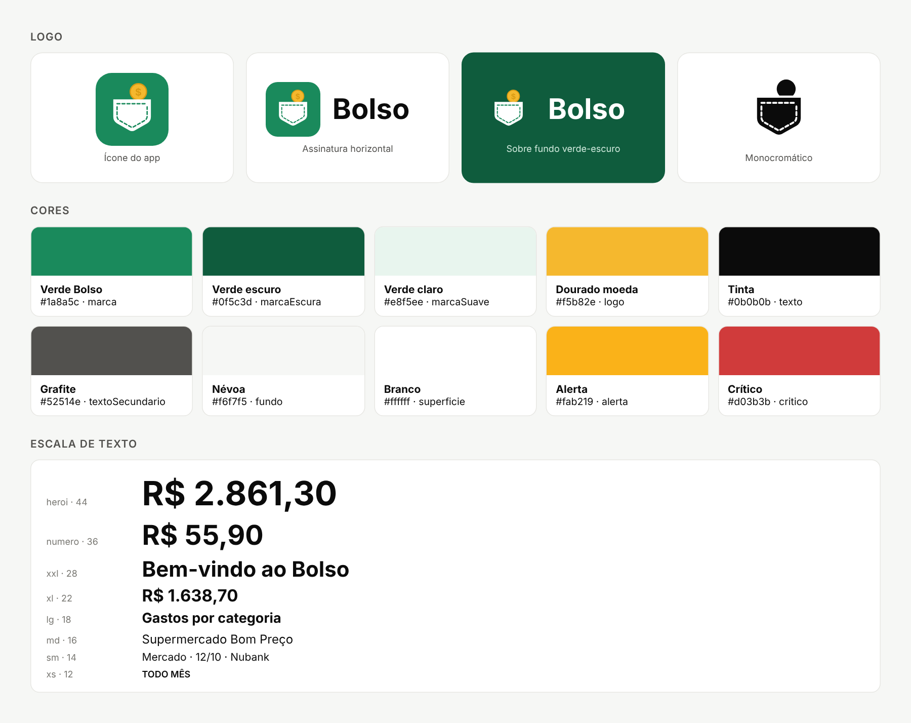

# Guia de marca do Bolso v1.0

> Atualizado em: 18/10/2026
> Situação: primeira versão
> Fonte de verdade das cores e medidas no código: `mobile/src/lib/tema.js` (tokens) e `mobile/src/lib/marca.js` (desenho do logo)



## Quick Reference · Resumo

| Elemento | Valor |
|---------|-------|
| Cor principal | #1a8a5c (Verde Bolso) |
| Cor de apoio | #f5b82e (Dourado moeda, só no logo) |
| Fonte | Fonte do sistema (Roboto no Android, SF Pro no iPhone) |
| Voz | Próxima, clara, honesta com os números, leve |
| Símbolo | Bolso de calça com uma moeda saindo |
| Frase | "Seus gastos no lugar certo" |

---

## 1. Essência da marca

### Missão

O Bolso organiza os gastos de quem não tem paciência para planilha: você manda a foto do cupom, a fatura ou só escreve "35 no uber", e a IA põe cada real no lugar certo, para você entender para onde vai o dinheiro sem esforço.

### Visão

Um mundo em que cuidar do próprio dinheiro leva um minuto por dia e não dá culpa.

### Proposta de valor

Para quem quer saber para onde vai o dinheiro, mas desiste de anotar gasto por gasto,
o Bolso é um app de controle de gastos
que entende cupom, fatura, extrato, comprovante de Pix, conta de consumo e texto livre.
Diferente dos apps que pedem tudo digitado em formulário,
o Bolso lê o que você já tem na mão e organiza sozinho.

### Posicionamento

O Bolso é o controle de gastos para quem não tem tempo de organizar,
porque a IA faz a parte chata: lê, separa por categoria, percebe o que se repete e avisa o que merece atenção.

### Mensagens principais

| Mensagem | O que a pessoa precisa | Prova (o que o app já faz) |
|---------|---------------|-------------|
| "Manda do jeito que estiver." | Registrar sem trabalho | Lê foto de cupom, QR Code da nota, PDF de fatura, CSV/OFX de extrato, Pix e texto livre |
| "Saiba para onde foi o dinheiro." | Entender os gastos | Painel com categorias, os últimos 6 meses e o orçamento do mês |
| "O Bolso avisa antes de doer." | Não ser pego de surpresa | Alertas de cobrança em dobro, reajuste de assinatura e cobrança depois de "vou cancelar" |
| "O que se repete, o Bolso lembra." | Não esquecer contas fixas | Gastos fixos lançados sozinhos todo mês |
| "Seu mercado está mais caro? Você vai saber." | Perceber a inflação no dia a dia | Histórico de preço por produto e inflação pessoal |
| "Pergunte em português." | Tirar dúvidas rápidas | "Pergunte ao Bolso": "Quanto gastei com Uber desde agosto?" |

### Apresentações rápidas

**10 segundos:** "O Bolso é um app que lê seus cupons e faturas e organiza seus gastos sozinho."

**30 segundos:** "Anotar gasto cansa, e por isso quase todo mundo desiste da planilha. No Bolso você só manda a foto do cupom, a fatura do cartão ou escreve '35 no uber'. A IA separa por categoria, mostra para onde foi o dinheiro e avisa quando algo foge do normal, como uma cobrança em dobro."

---

## 2. Color Palette · Cores

O verde é a cor do Bolso: dinheiro guardado, calma, "está tudo em ordem". O dourado só aparece na moeda do logo. O resto da interface é neutro, para que os números sejam o destaque.

### Primary Colors · Cores principais

| Nome | Hex | RGB | Uso | Token |
|------|-----|-----|-------|-------|
| Verde Bolso | #1a8a5c | rgb(26,138,92) | Botões, links, ícones ativos, fundo do ícone e da abertura | `cores.marca` |
| Verde escuro | #0f5c3d | rgb(15,92,61) | Cartão principal de conta, áreas de destaque com texto branco | `cores.marcaEscura` |
| Verde claro | #e8f5ee | rgb(232,245,238) | Fundo de botão secundário, opção selecionada, círculo de ícone | `cores.marcaSuave` |

### Secondary Colors · Cores de apoio

| Nome | Hex | RGB | Uso | Token |
|------|-----|-----|-------|-------|
| Dourado moeda | #f5b82e | rgb(245,184,46) | Só na moeda do logo | `MARCA.moeda` |
| Dourado borda | #d99a12 | rgb(217,154,18) | Contorno e cifrão da moeda | `MARCA.moedaBorda` |
| Verde névoa | #cfe9dc | rgb(207,233,220) | Texto secundário sobre o verde | `cores.sobreMarcaSuave` |

### Neutral Palette · Neutros

| Nome | Hex | RGB | Uso | Token |
|------|-----|-----|-------|-------|
| Névoa | #f6f7f5 | rgb(246,247,245) | Fundo das telas | `cores.fundo` |
| Branco | #ffffff | rgb(255,255,255) | Cartões, campos, barra de abas | `cores.superficie` |
| Linha | #e7e7e3 | rgb(231,231,227) | Bordas e divisórias | `cores.borda` |
| Tinta | #0b0b0b | rgb(11,11,11) | Títulos, valores, texto principal | `cores.texto` |
| Grafite | #52514e | rgb(82,81,78) | Texto de apoio, detalhes | `cores.textoSecundario` |
| Pedra | #7a7974 | rgb(122,121,116) | Dicas e exemplos dentro dos campos | `cores.textoSuave` |

### Semantic Colors · Cores de situação

Sempre acompanhadas de ícone e texto. A cor nunca é a única informação.

| Situação | Hex | Uso | Token |
|-------|-----|-------|-------|
| Atenção | #fab219 | Orçamento perto do limite, reajuste de assinatura | `cores.alerta` |
| Crítico | #d03b3b | Orçamento estourado, cobrança em dobro, apagar | `cores.critico` |
| Erro | #b42318 | Mensagens de erro em formulários | `cores.erro` |
| Sucesso | verde da marca | Confirmações ("Lançamento adicionado") | `cores.marca` |

### Gráficos

As categorias seguem uma ordem fixa de cores, validada para quem tem daltonismo: azul #2a78d6, laranja #eb6834, verde #1baf7a, amarelo #eda100 e rosa #e87ba4. "Outros" é sempre cinza #a8a6a1. A cor nunca muda com a posição no ranking, e a legenda sempre mostra o nome e o percentual.

### Accessibility · Contraste

Contraste medido pela fórmula do WCAG 2.1 (mínimo AA: 4,5:1 para texto normal, 3:1 para texto grande e ícones):

| Combinação | Contraste | Resultado |
|-----------|-----------|-----------|
| Tinta sobre branco | 19,7:1 | AAA |
| Grafite sobre névoa | 7,4:1 | AAA |
| Branco sobre verde escuro | 8,0:1 | AAA |
| Erro sobre fundo de erro | 5,8:1 | AA |
| Crítico sobre branco | 4,8:1 | AA |
| Verde Bolso sobre branco | 4,34:1 | AA só para texto grande e ícones |
| Branco sobre Verde Bolso (botões) | 4,34:1 | AA só para texto grande |
| Pedra sobre névoa | 4,06:1 | AA só para texto grande |

**Ajuste recomendado (ainda não aplicado):** o Verde Bolso fica a um passo do AA para texto normal. Escurecer para **#188156** (4,87:1 no branco, 4,53:1 na névoa) resolve sem mudar a cara da marca. A Pedra passaria para **#72716d** (4,89:1). Se aprovado, a troca é feita em uma linha em `tema.js` e em `marca.js`, e os ícones são gerados de novo.

---

## 3. Typography · Tipografia

### Font Stack

```css
--font-heading: 'System UI';
--font-body: 'System UI';
```

O Bolso usa a fonte do próprio celular: Roboto no Android e SF Pro no iPhone. Ela é familiar, carrega na hora, respeita o tamanho de letra escolhido pela pessoa e tem números claros para valores em reais.

### Type Scale · Escala

| Token | Tamanho | Peso | Uso |
|---------|---------|--------|-------------|
| `heroi` | 44 | Forte (700) | O número principal de uma tela (gasto do mês) |
| `numero` | 36 | Forte | Valor digitado num lançamento |
| `xxl` | 28 | Forte | Título de boas-vindas, totais grandes |
| `xl` | 22 | Forte | Valores de destaque em cartões |
| `lg` | 18 | Forte ou médio (600) | Títulos de seção, saudação |
| `md` | 16 | Regular (400) ou médio | Texto principal, campos, botões |
| `sm` | 14 | Regular | Detalhes, dicas, rótulos de campo |
| `xs` | 12 | Médio | Etiquetas ("todo mês"), legendas pequenas |

Regras:
- Três pesos apenas: regular (400), médio (600) e forte (700).
- O valor é sempre maior que o rótulo: "R$ 591" chama mais atenção que "Gastos".
- Nada abaixo de 12. Entrelinha de 20 para `sm` e 24 para `md`.

---

## 4. Logo Usage · Uso do logo

### Variants · Versões

| Versão | Arquivo | Quando usar |
|---------|------|----------|
| Ícone | `docs/marca/bolso-icone.svg` | Ícone do app, avatar de redes sociais, favicon |
| Assinatura horizontal | `docs/marca/bolso-horizontal.svg` | Topo de documentos, apresentações, site, sobre fundo claro |
| Assinatura em branco | `docs/marca/bolso-horizontal-branco.svg` | Sobre o verde escuro ou fotos escuras |
| Símbolo verde | `docs/marca/bolso-simbolo.svg` | Sobre fundo claro, quando o quadrado verde não cabe |
| Símbolo branco | `docs/marca/bolso-simbolo-branco.svg` | Sobre o Verde Bolso (tela de abertura) |
| Monocromático | `docs/marca/bolso-monocromatico.svg` | Impressão em uma cor, ícone temático do Android |

Os ícones do app (PNG) ficam em `mobile/assets/` e saem do mesmo desenho de `mobile/src/lib/marca.js`.

### Anatomia

- **Bolso:** branco, com a costura tracejada no verde da marca.
- **Moeda:** dourada, atrás do bolso e quase toda à mostra, com o cifrão no centro.
- **Ícone:** quadrado com cantos arredondados (22% do lado) no Verde Bolso.

### Clear Space · Área de respiro

Deixe livre em volta do logo pelo menos a largura da moeda (cerca de 1/4 do ícone).

### Minimum Size · Tamanho mínimo

| Contexto | Largura mínima |
|---------|---------------|
| Ícone, digital | 24 px |
| Assinatura horizontal, digital | 96 px |
| Ícone, impresso | 10 mm |
| Assinatura horizontal, impressa | 30 mm |

### Don'ts · Não faça

- Não gire, incline nem distorça o logo.
- Não coloque a moeda na frente do bolso nem a tire de lá.
- Não troque o dourado da moeda por outra cor, nem o verde do fundo.
- Não use o cifrão ou a moeda sozinhos como logo.
- Não adicione sombra, brilho, contorno ou gradiente além do que já existe.
- Não aplique sobre fotos ou fundos cheios de detalhe sem uma área lisa por trás.

---

## 5. Voice & Tone · Voz

### Brand Personality · Personalidade

| Traço | Descrição |
|-------|-------------|
| **Próximo** | Fala como um amigo organizado, de "você", sem formalidade |
| **Claro** | Frases curtas, palavras do dia a dia, números sempre visíveis |
| **Honesto com os números** | Mostra o que é, sem esconder nem exagerar; diz quando não sabe |
| **Leve** | Nunca dá bronca nem culpa; trata gasto como informação, não como pecado |

### Voice Chart · Somos / Não somos

| Traço | Somos | Não somos |
|-------|--------|------------|
| Próximo | "Gastou algo no almoço? Me conta que eu anoto." | "Prezado usuário, registre suas despesas." |
| Claro | "Você gastou R$ 412 no mercado este mês." | "Seus dispêndios na categoria alimentação apresentaram variação." |
| Honesto | "Em setembro inteiro foram R$ 3.072." (sem comparar mês pela metade) | "Você economizou 40%!" no dia 10 do mês |
| Leve | "Perto do limite. Vale segurar um pouco." | "Você estourou o orçamento de novo!" |

### Tone by Context · Tom por situação

| Situação | Tom | Exemplo real do app |
|---------|------|---------|
| Saudação | Acolhedor, muda com a hora do dia | "Bom dia, Coruja. Café tomado? Bora ver como estão as contas." |
| Confirmação | Curto, no passado | "Lançamento adicionado", "Gasto fixo pausado" |
| Erro de formulário | Calmo, com o exemplo do que serve | "Informe um valor válido, como 35 ou 35,90." |
| Alerta | Direto, com a ação logo embaixo | "Possível cobrança em dobro" + "Ver a 2ª cobrança" / "Está certo" |
| Assistente | Informativo, com o número na frente | "Seu maior gasto do mês foi R$ 1.400,00 em Aluguel." |
| Lista vazia | Convida, diz exatamente o que fazer | "Nenhum gasto neste mês. Toque no + para adicionar um cupom, uma fatura ou digitar um gasto." |

### Regras de escrita

- Valores sempre em reais e no formato brasileiro: R$ 1.250,90. Datas como 18/10.
- Comece pelo número ou pela ação, não pela explicação.
- Botões dizem o que acontece: "Salvar", "Vou cancelar", "Ver a 2ª cobrança", em vez de "OK" ou "Confirmar".
- Erro não leva ponto de exclamação e sempre diz como resolver.
- Sem emoji na interface; os ícones fazem esse papel.
- "IA" quando for preciso dizer quem fez ("marcado pela IA"); fora isso, quem faz é "o Bolso".

### Prohibited Terms · Evitar

| Avoid · Evitar (e o que usar no lugar) |
|-------|
| Revolucionário: promessa vazia, mostre o que o app faz |
| Insights: diga "dicas" ou "o que mudou" |
| Dashboard: diga "painel" |
| Alavancar ou otimizar suas finanças: jargão de banco, diga o que acontece |
| Fique rico: promessa que o app não cumpre |
| Você gastou demais: dá culpa, mostre o número e deixe a pessoa decidir |
| Despesa e receita: diga "gasto" e "entrada" (a categoria padrão "Outras receitas" ainda usa o termo antigo) |

---

## 6. Imagery Guidelines · Imagens e ícones

### Ícones

- Família: Ionicons, versão contornada ("outline"); a versão cheia só marca a aba ativa.
- Tamanhos: 16 em etiquetas e opções, 18 a 22 em listas, 24 na barra de abas.
- Cor: Grafite em listas, Verde Bolso em ações; nunca as cores dos gráficos.
- Ícone dentro de círculo (40 de diâmetro) para categorias e contas.

### Ilustrações e materiais de divulgação

- Estilo plano, formas simples e arredondadas, como o próprio bolso.
- Cores só da paleta: verde, verde escuro, dourado e neutros.
- Mostrar o app de verdade (telas reais) em vez de cenas genéricas de dinheiro.
- Pessoas reais em situações do dia a dia: mercado, ônibus, almoço, conta de luz.

---

## 7. Design Components · Componentes

Medidas vindas de `mobile/src/lib/tema.js`:

### Buttons · Botões

| Tipo | Fundo | Texto | Raio | Altura |
|------|------------|------|---------------|--------|
| Principal | Verde Bolso | Branco | 12 | 48 |
| Secundário | Verde claro | Verde Bolso | 12 | 48 |
| Texto (link) | Transparente | Verde Bolso | — | 44 de área de toque |
| Perigo (em diálogos) | Vermelho claro | Crítico | 12 | 48 |

### Spacing Scale · Espaços

| Token | Valor | Uso |
|-------|-------|-------|
| `xs` | 4 | Entre linhas de um mesmo bloco |
| `p` | 8 | Entre ícone e texto, entre opções |
| `pm` | 12 | Entre itens de uma lista |
| `m` | 16 | Margem das telas, padding dos cartões |
| `g` | 24 | Entre seções |
| `gg` | 32 | Respiro grande |
| `ggg` | 48 | Fim de listas, estados vazios |

### Border Radius · Cantos

| Elemento | Raio |
|---------|--------|
| Botões, campos, cartões | 12 |
| Cartões de destaque | 16 |
| Folhas que sobem de baixo | 24 |
| Opções, etiquetas, botão + | Pílula (totalmente arredondado) |

---

## 8. AI Image Generation · Imagens com IA

### Base Prompt Template

```
Flat, friendly illustration for a Brazilian personal finance app called Bolso. Clean shapes with soft rounded corners, plenty of white space, calm natural light. Palette strictly limited to emerald green #1a8a5c, deep green #0f5c3d, soft mint #e8f5ee, warm gold #f5b82e and off-white #f6f7f5. No text, no logos, no dollar bills flying, no stock-photo clichés.
```

### Style Keywords

| Categoria | Palavras-chave |
|----------|----------|
| **Lighting** | luz natural, suave, dia claro |
| **Mood** | calmo, organizado, confiante, leve |
| **Composition** | centralizado, um objeto principal, muito espaço livre |
| **Treatment** | cores chapadas, pouco contraste, sem texturas |
| **Aesthetic** | minimalista, plano, arredondado |

### Visual Mood Descriptors

- Calma de quem sabe para onde foi o dinheiro
- Dia a dia brasileiro: mercado, ônibus, cafezinho, conta de luz
- Organização sem rigidez

### Visual Don'ts

| Avoid · Evitar | Motivo |
|-------|--------|
| Notas voando, cofrinho de porco, gráfico subindo em seta | Clichê de finanças |
| Cores fora da paleta, neon, gradientes fortes | Quebra a identidade |
| Texto dentro da imagem gerada | Sai com erros e não traduz |
| Pessoas em escritório de terno | Não é o público do Bolso |

### Example Prompts

**Banner de divulgação:**
```
[Base Prompt] A hand dropping a gold coin into the back pocket of a pair of jeans, seen from behind, centered, mint background.
```

**Post para redes sociais:**
```
[Base Prompt] A smartphone lying on a café table next to a paper receipt and a coffee cup, screen glowing emerald green, top-down view.
```

---

## Changelog · Histórico

| Versão | Data | Mudanças |
|---------|------|---------|
| 1.0 | 18/10/2026 | Primeira versão: essência, cores com contraste medido, tipografia, logo, voz, ícones, componentes e prompts de imagem |
